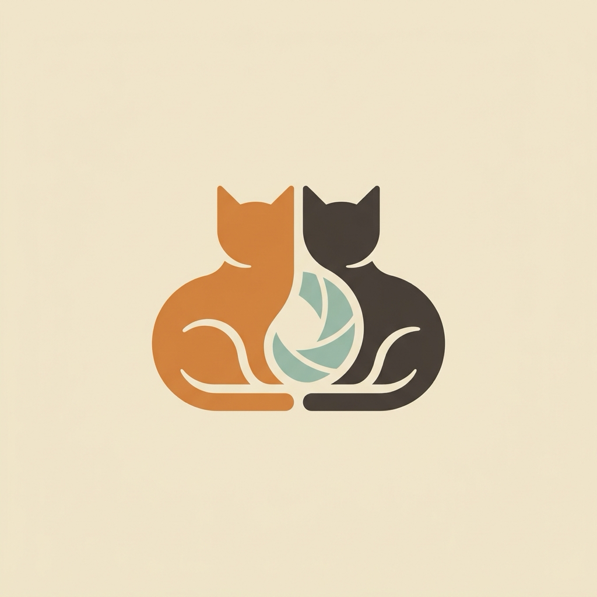
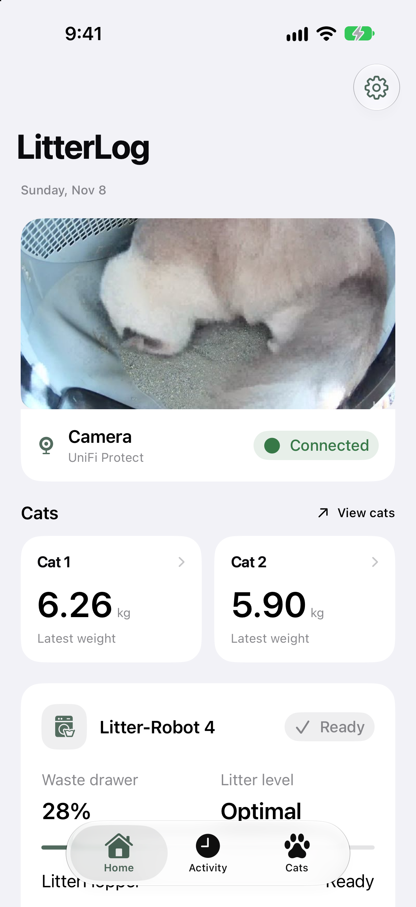
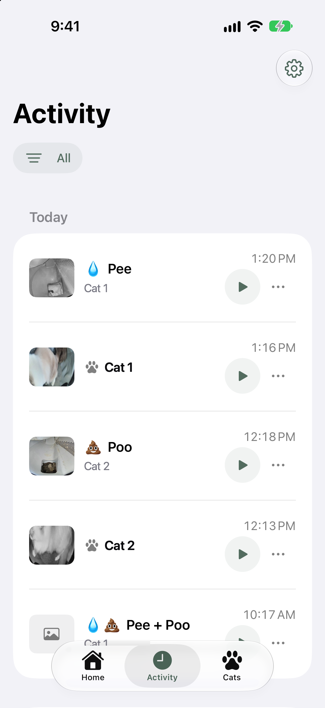
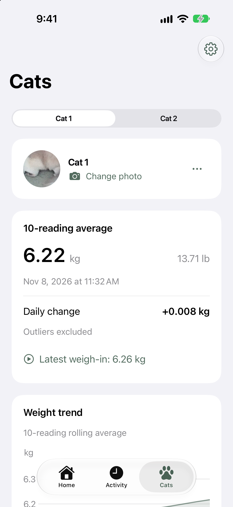
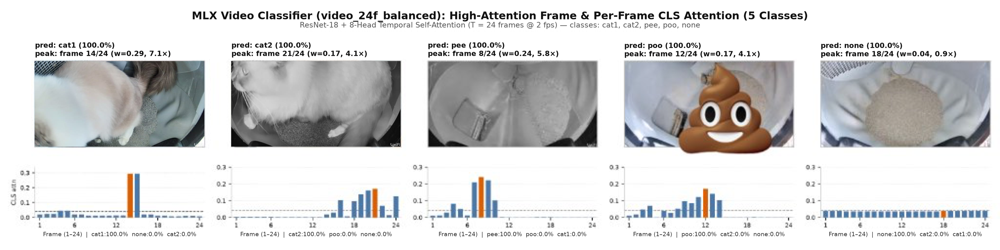
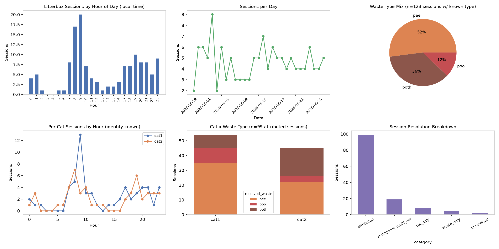

# LitterLog

One-stop shop for monitoring \*my\* two cats' litter box behavior: Litter Robot 4 control, with a UniFi Protect camera pointed at it, a small video model to classify each motion clip into which cat entered (`cat1` or `cat2`) and what the sift cycle picked up (`pee` or `poo`), an iOS app with home servers for running model inference on new clips, cross-referenced with Litter Robot weight reading by timestamp.

## Content
1. **iOS App (`App/`)**: Native SwiftUI app for live camera streaming, Litter-Robot 4 controls (`cycle`, `pause`, `reset`), activity clip playback, one-tap label fixes, and per-cat weight and bathroom history.
2. **Home Server (`server/`)**: `aiohttp` backend that proxies UniFi Protect HLS/MP4 video, talks to the Litter-Robot API, matches scale weigh-ins to visual cat detections and sifting clips, and runs CPU inference in Docker.
3. **Video Classifier (`classifier/`)**: `ResNet-18` + 8-head temporal self-attention over 24 frames (first 60s of each clip), written in [MLX](https://github.com/ml-explore/mlx). Classifies clips into `cat1`, `cat2`, `pee`, `poo`, or `none`.
4. **Self-Training (`classifier/self_training/`)**: Fine-tunes the model on relabels from the iOS app (`weight = 1.0`) combined with pseudo-labels from unreviewed clips (`weight = 0.25`).

## iOS App

<p>
  
  
  
</p>

- **Home**: Live camera feed, weight cards for each cat, waste drawer level, and clean/reset buttons (plus an option to auto-reset if a false alarm leaves the globe paused).
- **Activity**: Feed of motion clips with class filters. If the model gets a clip wrong, you can fix the label in one tap—it recalculates the cat's weight attribution right away and saves the correction for the next training run.
- **Cats**: Rolling weight averages (outlier-filtered over 10 readings) and daily pee/poo bar charts.
- **Siri & Demo Mode**: Includes a Siri Shortcut to start a clean cycle, and a built-in Demo Mode so the app works in Xcode without a server.

## Video Classifier



A single bathroom visit usually triggers two motion clips: the cat walking in and using the box (`cat1` or `cat2`), and the Litter-Robot rotating a few minutes later to sift the clumps (`pee` or `poo`). The model is trained to identify \*my\* two cats only, but the waste classification may be generally useful.

- **First 60s only**: Cat visits happen in the first 0–25s and waste sifting happens around 40–55s; anything past 60s is just the empty globe rotating home. Sampling 24 frames at 2 fps from the first 60s gets better accuracy than using the whole clip (`0.929` vs `0.912` macro-F1).
- **Model**: Pretrained `ResNet-18` frame features (`512 -> 128-d`) with a learnable `CLS` token and 8-head temporal self-attention ([`classifier/model.py`](classifier/model.py)).
- **Thumbnails from attention**: The `CLS` token's attention weights over the 24 frames point directly to the frame where the cat steps in or the clump drops into the waste port, so the server grabs the highest-attention frame as the event thumbnail.

### Test Split (92.1% accuracy, 0.928 macro-F1)

| Class | Description | Acc | F1 | Peak `CLS` Attention |
| :--- | :--- | :---: | :---: | :--- |
| `poo` | Solid waste during sift | 1.00 | 1.00 | ~40–50s (4.1x uniform) |
| `none` | Empty cycle / false trigger | 0.97 | 0.92 | Flat (~0.9x) |
| `pee` | Urine clump during sift | 0.92 | 0.96 | ~45–55s (5.8x uniform) |
| `cat2` | Cat 2 (mitted Ragdoll) | 0.90 | 0.88 | Entry/exit frames (4.1x) |
| `cat1` | Cat 1 (blaze Ragdoll) | 0.82 | 0.88 | Entry/digging frames (7.1x) |

Pretrained `.npz` checkpoints (~45 MB) are in [`classifier/checkpoints/`](classifier/checkpoints/). See [`classifier/README.md`](classifier/README.md) for more details on data annotation, label-balanced training, and model methods.



## Layout

```text
litterlog/
├── App/                        # SwiftUI iOS app
├── LitterLog.xcodeproj/   # Xcode project
├── server/                     # API, Protect/LR4 proxy, attribution, Docker worker
└── classifier/                 # MLX model, training, self-training, checkpoints
```

See [`server/README.md`](server/README.md) for the server setup and [`classifier/README.md`](classifier/README.md) for more on the model.

## Running It

### Classifier (Apple Silicon Mac + `ffmpeg`)

```bash
uv venv && source .venv/bin/activate
uv pip install -r requirements.txt

# Classify a video clip
python classifier/infer.py --video /path/to/clip.mp4 --ckpt-dir video_24f_balanced --topk 3

# Dump per-frame CLS attention weights and top frames
python classifier/attention_viz.py --video /path/to/clip.mp4 --ckpt-dir video_24f_balanced --out ./attn_out
```

To train from scratch or fine-tune on app relabels:

```bash
# 1. Download clips from UniFi Protect
python classifier/download_events.py --host nvr.local --user USER --pass PASS \
  --camera "Litter Box" --days 90 --output-dir ./unifi_data

# 2. Extract 256x256 frames at 2fps and create train/val/test split
python classifier/extract_frames.py --dirs ./unifi_data --fps 2 --workers 8 --size 256
python classifier/split_dataset.py --val-frac 0.15 --test-frac 0.15 --seed 42

# 3. Train base model
python classifier/train_video.py --batch-size 4 --n-frames 24 \
  --balanced --no-class-weights --trunc-prob 0.5 --lr 1e-4

# 4. Fine-tune on app relabels (w=1.0) + unreviewed predictions (w=0.25)
python classifier/self_training/train_all.py --run-dir ./classifier/runs/self_train_01
python classifier/self_training/evaluate.py --run-dir ./classifier/runs/self_train_01
```

### iOS App

Open [`LitterLog.xcodeproj`](LitterLog.xcodeproj) in Xcode, pick your signing team, and hit Run. It starts in Demo Mode by default; tap the gear icon in the top right to point it at your server.

## License

[MIT](LICENSE)
