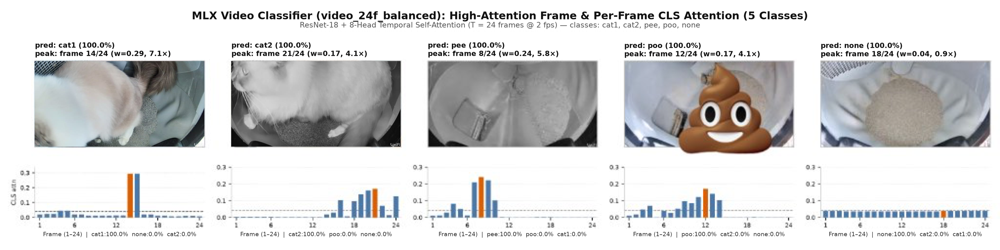

# LitterLog Video Classifier

Classifies UniFi Protect motion clips from the litterbox camera into 5 classes using `ResNet-18` + 8-head temporal self-attention in [MLX](https://github.com/ml-explore/mlx):

- `cat1` / `cat2`: Which of \*my\* cat used the box
- `pee` / `poo`: What clumps fell into the waste port during the sift cycle
- `none`: False motion trigger or empty cycle

A bathroom visit usually spans two motion clips: the cat enters and uses the box (`cat1` or `cat2`), and a few minutes later the Litter-Robot rotates to sift the waste (`pee` or `poo`). Grouping clips within a 12-minute window (`analysis/analyze_litterbox.py`) and matching timestamps against Litter-Robot scale readings links both waste type and body weight to the right cat.



## Data

I hand-labeled the original **699 clips** (29 days of UniFi Protect motion events) in about **4 hours** using [`label_clips.py`](label_clips.py), which reveals each clip in Finder for Quick Look and saves a `<clip>.txt` label on a single keypress (`1`/`2`/`p`/`o`/`n`), plus [`relabel.py`](relabel.py) to audit classes afterward.

Clips are split 70/15/15 by `clip_id` ([`split_dataset.py`](split_dataset.py), 487 train / ~106 val / ~106 test) so frames from the same video never leak across splits:

| Class | Clips (`699` total) | Share | Train (`487`) |
| :--- | :---: | :---: | :---: |
| `none` | 247 | 35.3% | ~173 |
| `cat1` | ~180 | 25.8% | ~126 |
| `cat2` | ~133 | 19.0% | ~93 |
| `pee` | ~87 | 12.4% | 55 |
| `poo` | ~52 | 7.4% | 44 |

Because `poo` and `pee` are much rarer than `none` or cat visits (~88% of shuffled `batch_size=4` batches had zero `poo` clips), training uses label-balanced round-robin batch sampling (`--balanced --no-class-weights` in [`video_dataset.py`](video_dataset.py)) to cycle evenly across all 5 classes each epoch.

## Test Split Results

Evaluated on the held-out clip split (`checkpoints/video_24f_balanced/best.npz`: **92.1% accuracy, 0.928 macro-F1**):

| Class | Acc | F1 | Peak `CLS` Attention |
| :--- | :---: | :---: | :--- |
| `poo` | 1.00 | 1.00 | Waste tumbling across the grate (~40–50s, 4.1x uniform) |
| `none` | 0.97 | 0.92 | Empty litter bed / rotation (flat, ~0.9–1.2x) |
| `pee` | 0.92 | 0.96 | Urine clump dropping into waste port (~45–55s, 5.8x) |
| `cat2` | 0.90 | 0.88 | Cat 2 entering or turning in the globe (4.1x) |
| `cat1` | 0.82 | 0.88 | Cat 1 entering or digging (7.1x) |

## Design Notes

### Capping clips at 60 seconds (`--max-seconds 60`)

UniFi Protect motion clips around the Litter-Robot can run 90–180s, but everything useful happens in the first minute: cat visits are in 0–25s, and clumps drop into the waste port at 40–55s. Past 60s, the empty globe is just rotating back to home position. Truncating at 60s improves macro-F1 (`0.929` vs `0.912` on full clips) because the 24 sampled frames aren't wasted on the empty tail, and it cuts NVR download sizes roughly in half.

### 30s fast pass vs. 60s full window

Running `eval_truncated.py` across clip prefixes (5s to 60s) shows that cat identity (`cat1`, `cat2`) reaches full accuracy by 20–30s since the cat is in frame right away, while `pee`/`poo` need 45–60s because sifting happens later in the cycle. In practice, you can classify the first 30s for quick cat identification and only re-run on the full 60s if the model predicts waste or confidence is under 80%.

### Frame extraction and sampling (`T = 24` @ `2 fps`)

- **Extraction (`extract_frames.py`)**: Extracts 2 fps at `256x256` with the first and last 1s trimmed. Decoding at native `2688x1512` took 26 GB; scaling to `256x256` in FFmpeg keeps the dataset around 700 MB with no accuracy drop at `224x224` model input.
- **Sampling (`video_dataset.py`)**: Each clip is 24 frames (`[24, 224, 224, 3]`). Training draws a sorted random subset of 24 frames each epoch; evaluation picks 24 evenly spaced frames.
- **Prefix truncation (`--trunc-prob 0.5`)**: To match early 30s inference, half of training clips are randomly truncated to a leading prefix (25–100% of duration) before sampling 24 frames.
- **Augmentation (`train.py`)**: Random crop (`256 -> 224`), horizontal flip, ±15° rotation, ±20% color jitter, and ImageNet normalization.

### Model architecture (`model.py`)

```text
Input: [B, 24, 224, 224, 3]
  -> Pretrained ResNet-18 (mlxim): [B*24, 512] -> Linear(512, 128)
  -> Prepend learnable CLS token: [B, 25, 128]
  -> LayerNorm -> 8-Head MultiHeadAttention (head_dim=16)
  -> Pool CLS token (position 0): [B, 128] -> Linear(128, 5)
```

- **Memory footprint**: At `batch_size=4` and `24` frames (`96` images per backward pass), `ResNet-18` (~11.3M params) fits in 8 GB of Apple Silicon memory without swapping. Forward pass takes ~0.18s (FFmpeg decode takes 7–15s).
- **Attention thumbnails (`attention_viz.py`, `infer.py`)**: Since the classifier head only reads the `CLS` token (`position 0`), the `CLS` attention weights over the 24 frame keys (`scores[:, :, 0, 1:]`, averaged across heads) show which frame drove the prediction. `infer.py` saves the peak-attention frame as the event thumbnail for the iOS app.

### Self-training on app relabels (`self_training/`)

When you fix or confirm a label in the iOS app (`CorrectionView.swift`), the server saves a `<clip>.txt` ground-truth file. `self_training/train_all.py` fine-tunes the base checkpoint (`video_24f_balanced/best.npz`) on both:

- **Human relabels / confirmations**: `weight = 1.0`
- **Model predictions on unreviewed clips (pseudo-labels)**: `weight = 0.25`

Original `val` and `test` clips from `split.json` stay locked to their splits so you can compare checkpoints directly via `self_training/evaluate.py`.

## Commands

```bash
uv venv && source .venv/bin/activate
uv pip install -r ../requirements.txt

# 1. Download clips from UniFi Protect
python download_events.py --host nvr.local --user USER --pass PASS \
  --camera "Litter Box" --days 90 --output-dir ./unifi_data

# 2. Extract 256x256 frames at 2fps and create split.json
python extract_frames.py --fps 2 --workers 8 --size 256
python split_dataset.py --val-frac 0.15 --test-frac 0.15 --seed 42

# 3. Train base model
python train_video.py --batch-size 4 --n-frames 24 \
  --balanced --no-class-weights --trunc-prob 0.5 --lr 1e-4

# 4. Evaluate and inspect attention
python eval_test.py --ckpt-dir video_24f_balanced
python eval_truncated.py --ckpt-dir video_24f_balanced --seconds 5 10 20 30 45 60
python attention_viz.py --split test --per-class 4 --ckpt-dir video_24f_balanced --out ./attn_out
python infer.py --video /path/to/clip.mp4 --ckpt-dir self_training --topk 3

# 5. Fine-tune on app relabels (w=1.0) + unreviewed predictions (w=0.25)
python self_training/train_all.py \
  --teacher checkpoints/video_24f_balanced/best.npz \
  --run-dir ./runs/self_train_01
python self_training/evaluate.py --run-dir ./runs/self_train_01
```

## Files

```text
classifier/
├── model.py              # ResNet-18 + 8-head CLS temporal attention
├── train_video.py        # Training loop, balanced sampling, early-clip val
├── video_dataset.py      # Clip grouping, 24-frame sampling, prefix truncation
├── train.py              # Spatial augmentation and shared helpers
├── split_dataset.py      # Clip-level train/val/test split generator
├── extract_frames.py     # Parallel FFmpeg 2fps 256x256 frame extractor
├── download_events.py    # UniFi Protect event downloader
├── infer.py              # Single-clip/batch inference + attention thumbnail
├── attention_viz.py      # Per-frame CLS attention weight dumper
├── eval_test.py          # Test split evaluation and confusion matrix
├── eval_truncated.py     # Accuracy vs. clip prefix duration benchmark
├── label_clips.py        # Terminal keypress labeler for unlabeled clips
├── relabel.py            # Terminal keypress auditor for existing labels
├── self_training/        # Fine-tuning on human relabels + pseudo-labels
├── analysis/             # Multi-cat session and waste attribution scripts
└── checkpoints/          # Pretrained .npz weights (video_24f_balanced, self_training)
```
