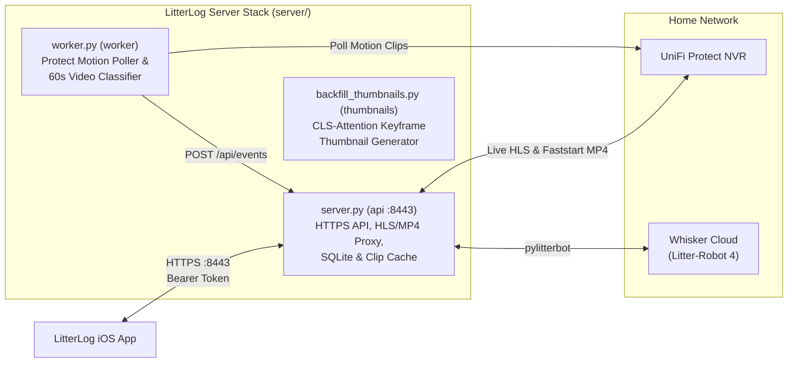

# LitterLog Home Server (`server/`)

Authenticated `aiohttp` HTTPS backend, UniFi Protect live/clip streaming proxy, Whisker Litter-Robot 4 controller (`cycle`, `pause`, `reset`), cross-referenced cat weight/visit attribution engine, and CPU/MLX background video inference worker.

---

## Architecture (`api` + `worker` + `thumbnails`)



### Key Components

| File | Description |
| :--- | :--- |
| [`server.py`](server.py) | Main `aiohttp` HTTPS server (`:8443` in Docker, `:8767` standalone). Manages persistent Whisker `LitterRobot4` session, SQLite event/weight store, live HLS/snapshot streaming, byte-range MP4 clip playback, and active-learning label overrides. |
| [`worker.py`](worker.py) | Polls UniFi Protect for new motion events on the litterbox camera, downloads clips, runs 60s video inference (`max_seconds=60`), extracts the highest `CLS`-attention frame as a thumbnail, and posts predictions to `/api/events`. |
| [`backfill_thumbnails.py`](backfill_thumbnails.py) | Background worker that watches recorded clips and backfills `CLS`-attention keyframe thumbnails (`attention-cache/{sha256}.jpg`). |
| [`attribution.py`](attribution.py) | Cross-references Litter-Robot 4 scale weight readings (`Pet Weight Recorded: X.XX lbs`) with camera cat-identity detections (`cat1`, `cat2`) and manual overrides. |
| [`cat_activity.py`](cat_activity.py) | Aggregates cat visits and subsequent waste-sifting clips (`pee`, `poo`) into daily per-cat bathroom visit counts. |
| [`protect_service.py`](protect_service.py) | UniFi Protect client for live RTSP-to-HLS transcoding (`live.m3u8`), snapshot fetching, historical motion event import, and `moov`-first MP4 faststart remuxing. |
| [`make_remote_cert.py`](make_remote_cert.py) | Generates a private local CA (`LitterLog-Local-CA.cer` for iOS trust) and leaf server certificate with SANs for LAN IP / hostname / Tailscale. |
| [`inference/cpu_infer.py`](inference/cpu_infer.py) | Portable PyTorch/NumPy inference runtime that loads the trained MLX `.npz` weights directly on Linux/ARM64/x86_64 CPU containers. |

---

## HTTP API Reference

All endpoints require `Authorization: Bearer <LITTERLOG_APP_TOKEN>` (media routes also accept `?token=<LITTERLOG_APP_TOKEN>` for `AVPlayer` playback):

| Method & Path | Description |
| :--- | :--- |
| `GET /api/robot` | Returns live Litter-Robot 4 status (`status`, `waste_drawer_percent`, `litter_level_percent`, `cycle_count`, `is_online`). |
| `POST /api/robot/command` | Sends `{"command": "cycle" \| "pause" \| "reset"}` to the Litter-Robot 4. |
| `GET /api/events` | Returns classified motion events with attributed cat identities, confidence scores, and attention thumbnail URLs (`/media/thumbs/{sha256}.jpg`). |
| `POST /api/events` | Used by `worker.py` to record or update a clip classification (`event_id`, `time`, `label`, `confidence`, `cat`). |
| `POST /api/events/{id}/override` | Saves a human ground-truth relabel (`{"cat": "cat1", "label": "pee"}`) or clears an override (`{"reset": true}`). |
| `GET /api/weights` | Returns historical Litter-Robot weight readings matched to cat identities (`cat1` / `cat2`) with linked video evidence (`video_event`). |
| `GET /api/cat-activity` | Returns daily per-cat `pee` and `poo` visit counts attributed across sessions. |
| `GET /api/camera` | Returns `{"mode": "video" \| "snapshots", "url": "/media/live.m3u8?token=..."}`. |
| `POST /api/recordings/import` | Imports recent motion recording metadata from UniFi Protect (`{"days": 7}`). |
| `GET /api/recordings/{event_id}/play` | Remuxes the Protect clip for HTTP byte-range `faststart` streaming and returns `{"url": "/media/clips/<sha256>.mp4?token=..."}`. |

---

## Running with Docker Compose (`docker-compose.yml`)

1. **Generate TLS Certificates**:
   ```bash
   python3 make_remote_cert.py --host 192.0.2.10 --hostname litterlog.local
   ```
   Install `certs/LitterLog-Local-CA.cer` on your iPhone (*Settings → General → VPN & Device Management* and enable full trust under *Settings → General → About → Certificate Trust Settings*).

2. **Populate the `litterlog-config` & `litterlog-model` Docker Volumes**:
   - Mount or copy your secret files into `litterlog-config` (`/run/litterlog`):
     - `app-token` (at least 24 characters)
     - `whisker-email` & `whisker-password`
     - `protect-host`, `protect-tls-name`, `protect-user`, `protect-password`, `protect-ca.pem`
     - `server-chain.pem`, `server.key`, `server-ca.pem`
   - Copy `classifier/labels.txt` and `classifier/checkpoints/video_24f_balanced/best.npz` into `litterlog-model` (`/models`).

3. **Build and Start**:
   ```bash
   docker compose up -d --build
   ```
